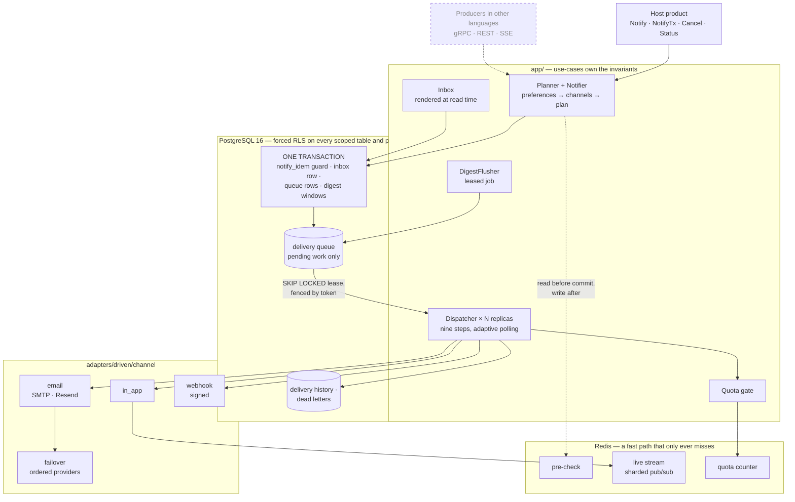

# 🔔 Intel Notification — Multi-Channel Notification Engine

### Persist once, fan out everywhere, deliver exactly once — and prove it never told the wrong person

**A reusable notification engine in Go: in-app, email, webhook and any channel you register, with a transactional outbox, per-recipient preferences, digests, quotas and a dead-letter path. Tenant isolation and exactly-once are properties of the schema, checkable by a test — not a vendor's assurance.**

[](https://github.com/truongpx396/intel-notification/actions/workflows/ci.yml)


[](./LICENSE)

> ## ⚠️ Status: design complete, **implementation partway through** (8 of 13 stages built)
> The **core is built and proven**: schema, domain rules, every port, the PostgreSQL adapter, the
> notifier, the reference channels, the dispatcher, digests and quotas — each guarantee held by a test
> that was broken on purpose to prove it fails. What is **not built**: the gRPC/REST/SSE transports, the
> one-call `New`, `Broadcast`, the retention and erasure *jobs*, and the adapters behind topics, templates
> and addresses. So today you adopt it as a Go library and **wire the pieces by hand** (see
> [Wiring it as a library](#-wiring-it-as-a-library)); service mode is designed and not runnable.
>
> [ROADMAP.md](ROADMAP.md) says what exists, what is designed and what is absent;
> [tasks.md](specs/001-notification-core/tasks.md) is the build order.
>
> **Scope, stated honestly:** this is a *delivery* engine — it decides who gets told what, on which
> channel, once. It is **not** a marketing campaign tool and **not** an on-call escalation system (that
> is [Phase 2](specs/002-escalation-workflows/), designed and not built). If you need neither
> multi-channel fan-out nor recipient-scoped durability, [ROADMAP.md](ROADMAP.md) names the tools you
> probably want instead.

---

## 📑 Table of Contents

- [🎯 Highlights](#-highlights)
- [🧭 Architecture](#-architecture)
- [💡 Why this exists](#-why-this-exists)
- [🧩 Seams, swapped independently](#-seams-swapped-independently)
- [🚀 Quickstart](#-quickstart)
- [🧪 Things to run](#-things-to-run)
- [🔌 Wiring it as a library](#-wiring-it-as-a-library)
- [✅ What it guarantees](#-what-it-guarantees)
- [📨 Channels](#-channels)
- [🧰 Configuration](#-configuration)
- [🔬 Testing](#-testing)
- [🔧 Make targets](#-make-targets)
- [📁 Repo map](#-repo-map)
- [🚧 Roadmap and known gaps](#-roadmap-and-known-gaps)
- [🩺 Troubleshooting](#-troubleshooting)
- [📚 Further reading](#-further-reading)
- [📄 License](#-license)

---

## 🎯 Highlights

| Layer | Tool | Built? |
|---|---|---|
| **Language** | Go 1.26, a hexagon enforced by `go-arch-lint` and `depguard` | ✅ |
| **Durable store** | PostgreSQL 16: partitioned inbox, history and dead letters; forced row-level security | ✅ |
| **Fast path** | Redis: duplicate pre-check (can only miss), live stream, quota counters | ✅ |
| **Channels** | `in_app`, `email` (SMTP, Resend), signed `webhook`, provider `failover` | ✅ |
| **Transports** | gRPC producer API, REST + SSE recipient API, in-process port | 🚧 designed |
| **Catalog** | Topics, versioned templates and addresses as data, managed over the API | 🚧 designed |
| **Escalation** | Acknowledgement, escalation chains, workflows ([Phase 2](specs/002-escalation-workflows/)) | 🚧 designed |

- 🧾 **Transactional outbox.** Accepting a notification is one transaction: the idempotency guard, the
  inbox row, one queue row per enabled channel and the digest windows. A crash cannot lose a delivery.
- 🔐 **Tenant isolation in the schema.** One forced RLS policy on every scoped table *and every
  partition*; scope is set per transaction. Verified as the non-superuser table owner.
- 🎯 **Exactly-once per recipient.** `notify_idem` keyed by realm, tenant and recipient, written first,
  within a bounded window. A fast Redis check sits in front but can only ever *miss*.
- 🔁 **Fenced leases.** Dispatcher replicas claim with `SKIP LOCKED`; every outcome write presents the
  lease token, so a stale worker's write is discarded.
- ☠️ **Poison terminates.** Attempts are counted at claim, so even a delivery that crashes its worker
  reaches the ceiling. Only genuine failures become dead letters, and a dead letter can be replayed once.
- 📬 **Digests and quotas.** A burst becomes bounded digests; an exhausted tenant's backlog is moved out
  of the claim range in one statement, so one noisy tenant cannot starve another.
- 🧩 **Opaque identity, pluggable channels.** `Recipient` and `Tenant` are `{kind, id}` pairs the engine
  never parses. Adding a channel is one `Register` call — demonstrated by adding `webhook` with no change
  to fan-out, persistence or preferences (NS-008).
- 📏 **Bounded growth, everywhere.** Partitions, windows, or pending-only by construction.
- 📜 **Spec-first.** A [constitution](.specify/memory/constitution.md), a normative
  [specification](specs/001-notification-core/), 46 recorded decisions and 16 invariants — each decision
  names the failure it prevents.

---

## 🧭 Architecture

Producers call a driving port; the engine commits one transaction; any number of dispatcher replicas
claim the resulting work and call channels. Dashed boxes are designed and **not built yet**.



**Ports and adapters.** `domain/` is pure rules and imports nothing from the module. `ports/` holds the
interfaces. `app/` holds the use-cases and depends only on `domain`, `ports` and the configuration. Every
adapter implements a port and never calls a use-case. The graph is a build failure if it is violated, not
a review comment.

**How a notification moves**, across several files:

1. `Notify` plans the delivery — topic lookup, preference resolution, quotas peeked — then commits the
   guard, the inbox row, one queue row per enabled channel and the digest windows **in one transaction**.
   It returns at commit and never waits on a provider (NS-003).
2. A dispatcher claims queue rows under a `SKIP LOCKED` lease fenced by a token, resolves every address of
   the recipient, checks suppression and quota, renders the template, calls `Channel.Deliver` and records
   the outcome.
3. Retryable results back off with full jitter; a dead address becomes a suppression; exhausted attempts
   become a dead letter with a reason; an undelivered channel falls back to the next one.
4. A finished delivery leaves the queue for the delivery history. **The queue holds pending work only.**

---

## 💡 Why this exists

Every product rebuilds this, and every rebuild makes the same mistakes. This engine is the same
machinery with those mistakes designed out:

| The usual mistake | What it costs | What this does instead |
|---|---|---|
| Recipient hard-coded as `(workspace_id, user_id)` | Notifying an org, a device, or a Slack channel becomes a schema + RLS rewrite | `Recipient` and `Tenant` are **opaque** `{kind, id}` pairs the engine never parses |
| Channels hard-coded as an `if` ladder | Adding SMS means editing the fan-out, and the fan-out is the riskiest code you own | A **`Channel` registry** read through capabilities — adding a channel is one `Register` call |
| Event type as a Postgres `enum` | Every new notification kind is an `ALTER TYPE` migration | A **`Topic` registry** — a registered string with data-driven defaults and a fallback chain |
| `INSERT` + publish + email, not transactional | A crash between them **silently loses the email**, and the fast dedup guard makes it permanent | A **transactional outbox**: row + per-channel entries in one transaction, claimed under fenced leases |
| Producer notifies after its own commit | A crash in between loses the notification | **`NotifyTx`** enqueues inside the producer's transaction |
| A shared queue drained oldest-first | One tenant's burst delays everyone else | An exhausted tenant's backlog is **moved out of the claim range** in one statement |

The fourth one is not hypothetical. It is the bug this design was extracted to fix — see
[the bug this fixes](#the-bug-this-fixes) below.

### The bug this fixes

The originating design guarded its fan-out with a Redis `SET NX notify:applied:{idem_key}` that
short-circuited **the entire handler**. Consider attempt #1: it sets the guard, inserts the row, then
crashes *before* enqueuing the email. The redelivery hits the guard and short-circuits — so the email is
**never sent, and never can be**. The guard made the loss permanent.

Here channel delivery is driven off the committed queue, so a crash anywhere leaves durable work. The
fast Redis check stays as what it should always have been: a read-only optimization, written only after
commit, that can skip a database round-trip and can never skip a notification.

---

## 🧩 Seams, swapped independently

A host adopts this by supplying its own specifics and touching none of the delivery core. In service
mode each of these is data the service owns, managed over the API.

| Seam | You provide | The engine never | Reference implementation today |
|---|---|---|---|
| **`Channel`** | your delivery targets and their dedup guarantees | branches on a channel kind | `in_app`, `email`, `webhook`, `failover` |
| **`TopicRegistry`** | your event vocabulary + defaults | special-cases a topic | the host's; data-backed adapter is Stage 11 |
| **`Recipient` / `Tenant`** | your identity + isolation model | parses either one | n/a — opaque by design |
| **`TemplateRenderer`** | your copy, i18n, branding | knows what a notification says | the host's; data-backed adapter is Stage 11 |
| **`AddressBook`** | where each recipient receives — every device | assumes one address per channel | the host's; data-backed adapter is Stage 11 |
| **`PreferenceStore`** | your opt-in model, per recipient and per tenant | assumes a channel is on | PostgreSQL |
| **`Store`** | your infra | requires a specific database | PostgreSQL + Redis |

---

## 🚀 Quickstart

**Prerequisites:** Go 1.26 (`go.mod` pins the toolchain), Docker for everything marked *needs Docker*,
[`golangci-lint`](https://golangci-lint.run/docs/welcome/install/) v2 and
`go install github.com/fe3dback/go-arch-lint@v1.19.0` for the lint targets, Node 24 for the e2e typecheck
(`e2e/.nvmrc`).

```bash
git clone https://github.com/truongpx396/intel-notification.git
cd intel-notification

make test              # unit tests: -race -shuffle=on, no Docker, no network
make verify-schema     # migrations + schema assertions on a throwaway PostgreSQL 16 (Docker)
make test-integration  # the adapters and use-cases against PostgreSQL 16 via Testcontainers (Docker)
make ci                # everything CI runs today
```

To poke at the real infrastructure, start only the two services that exist. The compose file applies
`migrations/` on first boot of an empty volume:

```bash
docker compose -f deploy/docker-compose.yml up -d postgres redis
```

| Service | Port | Notes |
|---|---|---|
| PostgreSQL 16 | `5432` | database `notify`, user and password `postgres` — matches `NOTIFY_PG_DSN` in [`.env.example`](.env.example) |
| Redis 7 | `6379` | `noeviction` on purpose: an evicted quota counter would silently raise a tenant's ceiling |
| Mailpit | `8025` / `1025` | only with `--profile e2e`; captures outgoing mail for the Playwright suite |
| `notifyd` | `8080` / `9090` | **does not build yet** — `cmd/notifyd` is Stage 10–11; see the note in [`deploy/Dockerfile`](deploy/Dockerfile) |

---

## 🧪 Things to run

The fastest way to see what is real is to run the test that proves it.

| Run | What it shows |
|---|---|
| `make verify-schema` | Reproduces the inherited-constraint failure that forces the idempotency guard into its own table ([D2](specs/001-notification-core/design-decisions.md#d2)), then asserts every schema guarantee as the table owner |
| `go test -race -shuffle=on -count=1 -tags integration -run TestFencedWrites ./adapters/driven/postgres` | A stale worker's write is discarded by the lease token |
| `… -run TestClaimLeasesAndSkipsLockedRows` | Concurrent claimers never see the same row; poison reaches the attempt ceiling |
| `… -run TestDeferTenantChannel` | An exhausted tenant's backlog leaves the claim range |
| `… -run TestDigestAppendUnderConcurrency` | One open digest window per `(recipient, topic, channel)` under real concurrency |
| `go test -race -shuffle=on -count=1 -run TestDispositionOf ./domain` | The terminal-outcome policy, in microseconds, with no infrastructure |
| `make bench` / `make soak` | What one PostgreSQL primary sustains: queue throughput, claim latency under backlog, bloat under sustained load (Docker; minutes to hours; not in `ci`) |

Tests are shuffled and parallel, so always pass `-race -shuffle=on -count=1`. Integration tests sit
behind the `integration` build tag; point gopls at `"buildFlags": ["-tags=integration"]` or your editor
will hide them.

---

## 🔌 Wiring it as a library

There is no one-call constructor yet. A host builds the pieces and passes them in one `app.Deps`. This
compiles against the module today; the four seams in the first block are the host's own
implementations (a data-backed set arrives in Stage 11).

```go
// The host's implementations of the seams the engine does not ship yet.
var (
    channels  ports.ChannelRegistry  // Register(Channel), Get(kind), Kinds()
    topics    ports.TopicRegistry    // your event vocabulary and defaults
    renderer  ports.TemplateRenderer // your copy and i18n
    addresses ports.AddressBook      // where each recipient receives
)

pool, _ := pgxpool.New(ctx, os.Getenv("NOTIFY_PG_DSN"))
rdb := goredis.NewClient(redisOpts)

cfg := notify.Config{
    Realm:    "my-product", // required, no default: isolates this product's idempotency key space
    StoreDSN: os.Getenv("NOTIFY_PG_DSN"),
    RedisURL: os.Getenv("NOTIFY_REDIS_URL"),
}.WithDefaults()
if err := cfg.Validate(); err != nil { /* every problem, in one error */ }

store := postgres.New(pool)       // Store, Queue, Digests and Maintenance in one type
quotas := postgres.NewQuotas(pool)
stream := redis.NewStream(rdb)

channels.Register(inapp.New(stream))                     // adding a channel is a line, not a refactor
channels.Register(email.New(mailer, topics, links))

deps := app.Deps{
    Channels: channels, Topics: topics, Renderer: renderer, Addresses: addresses,
    Store: store, Queue: store, Digests: store, Maintenance: store,
    Inbox:         postgres.NewInbox(pool),
    Prefs:         postgres.NewPreferences(pool),
    Suppressions:  postgres.NewSuppressions(pool),
    Quotas:        redis.NewQuota(rdb, quotas),
    QuotaPolicies: quotas,
    Stream:        stream,
    PreCheck:      redis.NewPreCheck(rdb), // optional: nil makes every Notify take the durable path
}

notifier, _ := app.NewNotifier(cfg, deps)
dispatcher, _ := app.NewDispatcher(cfg, deps)
go dispatcher.Run(ctx) // any number of replicas is safe: claims are leased and fenced

// Producers depend on ports.Notifier only.
notifier.Notify(ctx, domain.Notification{
    Tenant:    domain.Tenant{Kind: "workspace", ID: wsID},
    Recipient: domain.Recipient{Kind: "user", ID: userID},
    Topic:     "ingestion_complete",
    Data:      map[string]any{"doc_name": docName}, // templates own the copy
    IdemKey:   "ingest:" + docID + ":complete",      // REQUIRED — the exactly-once identity
})
```

Each constructor checks only the `Deps` fields it uses and names every missing one in a single error, so
a host that builds the notifier alone can leave the dispatcher's ports empty. To enqueue inside your own
transaction, call `NotifyTx(ctx, tx, n)`; the engine never commits or rolls it back.

**Not built yet** — these appear in the design and the [integration guide](docs/integration-guide.md)
as the intended interface, but do not exist in code:

- `app.New(cfg, deps)` returning every port at once, and `grpcclient.New(conn)` as a drop-in for it —
  swapping from library to service mode will change one line, because both satisfy `ports.Notifier`.
- Producers in other languages over the generated `notify.v1` client.
- `Notifier.Broadcast`, and the data-backed `TopicRegistry`, `TemplateRenderer` and `AddressBook`.

---

## ✅ What it guarantees

| Guarantee | How it is enforced | Verified |
|---|---|---|
| **A notification reaches only its recipient** | One forced RLS policy on every scoped table **and every partition**; scope set per transaction; the live stream keyed by the identity's hash and re-read under RLS | [TEST 4–6](scripts/verify-schema.sql), stream contract test |
| **Once per recipient** | `notify_idem` keyed by realm, tenant and recipient, written first in the same transaction, within a bounded window | [TEST 1–3](scripts/verify-schema.sql) |
| **Once per channel, stated honestly** | Each channel declares provider, local or no deduplication on a per-address delivery key; the engine reports it | channel contract test |
| **No delivery lost to a crash** | Inbox row + queue rows in one transaction; `SKIP LOCKED` leases; stale workers fenced by token | [`TestClaimLeasesAndSkipsLockedRows`, `TestFencedWrites`](adapters/driven/postgres/queue_integration_test.go) |
| **Poison terminates** | Attempts counted at claim, so even a delivery that crashes its worker reaches the ceiling; genuine failures dead-lettered with a reason | [`TestClaimLeasesAndSkipsLockedRows`, `TestFinish`](adapters/driven/postgres/queue_integration_test.go) |
| **A burst becomes bounded digests** | One open window per `(recipient, topic, channel)`, sealed at `DigestMax`, flushed once | [TEST 7](scripts/verify-schema.sql), [`TestDigestAppendUnderConcurrency`](adapters/driven/postgres/digest_integration_test.go) |
| **One noisy tenant cannot starve another** | Quotas with a realm default; an exhausted tenant's backlog leaves the claim range | [`TestDeferTenantChannel`](adapters/driven/postgres/queue_integration_test.go) |
| **Storage stays bounded** | Partitioned inbox, history and dead letters; windowed idempotency; a queue that holds pending work only | [TEST 8–9](scripts/verify-schema.sql), [`TestFinish`, `TestExpireIdem`](adapters/driven/postgres/) |
| **Erasable** | One call removes a recipient everywhere; suppressions survive as hashes | [TEST 11](scripts/verify-schema.sql), [`TestErase`](adapters/driven/postgres/maintenance_integration_test.go) |

> **Read the last two rows precisely.** Retention and erasure are proven at the schema and the adapter.
> The use-cases that schedule them — the leased retention jobs, `Admin.Erase`, the startup preflight —
> are Stage 8 and are **not built**, so a host that needs them today calls the `Maintenance` port itself.

Two suites prove these, both **as the table owner** — the role a worker actually uses, neither
superuser nor BYPASSRLS:

- `make verify-schema` applies the migrations to a throwaway PostgreSQL 16 and asserts what the schema
  alone holds: constraints, forced row-level security, key spaces.
- `make test-integration` runs every queue state transition — SQL in the Go adapter — against a real
  PostgreSQL 16 started by Testcontainers, in parallel, one cloned database per test. Each guarantee was
  mutation-checked: break it on purpose and a named test fails ([docs/mutations.md](docs/mutations.md)).

---

## 📨 Channels

Each channel depends on `domain` and `ports` only, and each is held to the same `ChannelContract`.

| Channel | Package | What it does |
|---|---|---|
| **In-app** | `channel/inapp` | Publishes a *nudge* naming a notification on the identity's stream key. The payload is never the content: the relay that consumes it (Stage 10) re-reads the row under RLS |
| **Email** | `channel/email` | SMTP and Resend mailers; RFC 8058 `List-Unsubscribe` headers and footer; signed unsubscribe links. Resend's idempotency was checked against its sandbox (`make test-provider`) |
| **Webhook** | `channel/webhook` | Signed POSTs. Added with no change to fan-out, persistence or preferences — the NS-008 demonstration |
| **Failover** | `channel/failover` | An ordered list of providers behind one channel; reports the *weakest* `Dedup` of its members, honestly |

SMS, push and Slack are one more `Register` call each; none is written yet.

---

## 🧰 Configuration

`notify.Config` is the **entire** configuration surface. The core reads no environment variables and no
global config; adapters dial what they are given. The ones you will reach for first:

| Field | Default | Why you would change it |
|---|---|---|
| `Realm` | **required** | Isolates this product's idempotency key space. Two products must not share one |
| `StoreDSN` / `RedisURL` | **required** | PostgreSQL and Redis |
| `Shards` | `16` | Claim-contention hint; changeable online |
| `ClaimLease` | `5m` | Must exceed the slowest channel's send timeout |
| `PollInterval` | `500ms` | The idle ceiling on claim latency |
| `MaxAttempts` | `5` | Claims per delivery before it dead-letters |
| `BackoffBase` / `BackoffCeiling` | `10s` / `1h` | Full-jitter retry curve |
| `IdempotencyWindow` | `7d` | How long an `IdemKey` guards replays; minimum 24h |
| `DigestMax` | `100` | Notifications per digest window before it seals |
| `RetentionWindow` | `90d` | Inbox partitions older than this are retired, read and unread |

Every field, its default and the decision behind it: [docs/configuration.md](docs/configuration.md).
**Provider credentials never go in config or env**: `channel_providers` rows reference them
(`env:NAME`, `file:/run/secrets/x`).

---

## 🔬 Testing

The workflow is test-driven: the failing test is written first, **run, and its failure read** — it must
fail on its assertion, not on a compile error, a skip or a missing container. A task box is ticked only
when the red was witnessed, `make ci` is green, and each new guarantee has a row in the
[mutation ledger](docs/mutations.md). Each guarantee is asserted at the lowest layer that can hold it.

| Layer | Tool | What it proves | Run |
|---|---|---|---|
| **Unit** | `go test`, table-driven, parallel | Pure rules in `domain/`: the canonical encoding and every derived key (frozen vectors), shard, backoff, the terminal-outcome policy | `make test` |
| **Schema** | `psql` on a throwaway PG 16 | Constraints, forced RLS on every scoped table and partition, key spaces | `make verify-schema` |
| **Integration** | `-tags integration` + Testcontainers | Every state transition, as the non-superuser owner, with real concurrency | `make test-integration` |
| **End to end** | Playwright | The running service as a host's front end sees it | `make e2e-list` now; `make e2e` once the service exists |
| **Benchmark** | `go test -bench` | What one PostgreSQL primary sustains. Not a pass/fail gate | `make bench`, `make soak` |
| **Boundaries** | `golangci-lint`, `go-arch-lint` | The hexagon's dependency graph and the test conventions | `make lint arch-lint` |

There is deliberately **no fake `Queue` or `Store`** in the test kit: leases, fencing and RLS are
properties only PostgreSQL can hold. `internal/notifytest` provides everything else — a fake clock, fault
injection, a probe, in-memory fakes, `Env`, and the `NotifierContract` and `ChannelContract` suites.
Conventions and the full rationale: [docs/testing.md](docs/testing.md).

---

## 🔧 Make targets

Run `make help` for the live list.

| Group | Target | Does |
|---|---|---|
| **Build and test** | `make build` | `go build ./...` |
| | `make test` | Unit tests, race detector, shuffled; no Docker |
| | `make test-integration` | Integration tests via Testcontainers (Docker) |
| | `make test-provider` | Email-channel suites against the provider's sandbox; needs `NOTIFY_PROVIDER_RESEND_API_KEY`; not in `ci` |
| **Schema** | `make verify-schema` | Migrations + schema assertions on a throwaway PG 16 (Docker) |
| | `make lint-sql` | Migration hygiene: `BEGIN`/`COMMIT`, header comment, sequential numbering |
| **Quality gates** | `make lint` | `golangci-lint`: depguard boundaries, `paralleltest`, goimports |
| | `make arch-lint` | `go-arch-lint`: the hexagon's dependency graph |
| | `make docs-links` | Fails on a dangling relative markdown link |
| **End to end** | `make e2e-list` | Typecheck the Playwright suite and list it, no stack needed |
| | `make e2e` | Run it against the compose stack (Docker, Node 24); switches on with the HTTP layer |
| **Performance** | `make bench` | Queue throughput benchmarks (Docker; minutes) |
| | `make soak` | Sustained-load soak for `SOAK_DURATION`, default `10m` (Docker; up to hours) |
| **Everything** | `make ci` | `lint-sql verify-schema docs-links build test test-integration lint arch-lint e2e-list` |

---

## 📁 Repo map

```text
.
├── domain/              pure rules; imports nothing from the module. Canonical encoding and every
│                        derived key (keys.go), shard, backoff, terminal-outcome policy, dispatch steps
├── ports/               driven.go and driving.go — the interfaces every other layer depends on
├── app/                 use-cases: planner, Notifier, Inbox, Dispatcher, DigestFlusher, quota gate;
│                        Deps is the one struct they are all built from
├── adapters/
│   └── driven/
│       ├── postgres/    delivery queue, digests, maintenance, store, inbox, prefs, suppressions, quotas
│       ├── redis/       pre-check, live stream, quota counter
│       └── channel/     inapp · email · failover · webhook
├── migrations/          the schema, embedded as migrations.FS (hosts, tests and the service share it)
├── config.go            notify.Config — the one configuration surface
├── internal/
│   ├── notifytest/      the kit every suite is written against (clock, faults, probe, fakes, Env)
│   ├── pgtest/          Testcontainers PostgreSQL, one cloned database per test
│   └── redistest/       Testcontainers Redis
├── scripts/             verify-schema.sql and its helpers
├── specs/
│   ├── 001-notification-core/   spec, plan, data-model, design-decisions, tasks, contracts/
│   └── 002-escalation-workflows/
├── docs/                integration-guide, configuration, operations, security, testing, mutations
├── e2e/                 Playwright suite, written against the contract; switches on with the HTTP layer
├── deploy/              Dockerfile (intended shape) and docker-compose.yml
├── design-system/       reference inbox and preferences UI a host builds on the REST contract
├── .specify/            the constitution
├── .github/workflows/   ci.yml, provider.yml
├── ROADMAP.md           scope, phases, and when to use something else
└── PROVENANCE.md        where this came from and what changed in the lift and the review
```

Not created yet: `adapters/driving/`, `api/`, `cmd/`. Their lines in `.go-arch-lint.yml` are commented out
and are uncommented in the change that creates each directory.

---

## 🚧 Roadmap and known gaps

Task-level status lives in [tasks.md](specs/001-notification-core/tasks.md); scope, phases and
non-goals live in [ROADMAP.md](ROADMAP.md).

| Stage | What | Status |
|---|---|---|
| 1 | Schema — migrations, partition provisioning, `verify-schema` | ✅ built |
| 2 | Domain and ports — types, keys, shard, backoff, `Config`, the test kit | ✅ built |
| 3 | Store adapter — queue, persist and read paths, inbox, preferences, suppressions | ✅ built |
| 4 | Notifier — planner, `Notify`, `NotifyTx`, `Cancel`, `Status`, Redis pre-check, recipient inbox | ✅ built |
| 5 | Channels — Redis stream, `inapp`, `email`, unsubscribe tokens, `failover` | ✅ built |
| 6 | Dispatcher — the nine steps, retries, suppression, dead letters and replay, `webhook` | ✅ built |
| 7 | Digest, quotas, fairness — leased flush job, Redis counter, noisy-neighbour test | ✅ built |
| 8 | Maintenance — leased retention jobs, `Admin.Erase`, startup preflight | 🚧 not built |
| 9 | Broadcast — durable, paged, resumable | 🚧 not built |
| 10 | Transports — gRPC, REST, SSE relay, in-process port | 🚧 not built |
| 11 | Service mode — data-backed topics, templates and addresses; recipient token verification; NATS ingest | 🚧 not built |
| 12 | Boundary gates — arch-lint, depguard, builds with no host present | ✅ built |
| 13 | Load test and release — capacity harness, integration-guide samples, tag `v0.1.0` | 🚧 not built |

**Not built, and what that means today**

- **No service.** There is no `cmd/notifyd`, no gRPC, no REST and no SSE relay; `deploy/Dockerfile` is the
  intended shape and cannot build, and the Playwright suite is typechecked and listed but not run.
- **No one-call `New`.** A host assembles `app.Deps` by hand, as above.
- **No `Broadcast`.** `Notifier.Broadcast` is a stub that returns an error (T042), and its adapter is not built.
- **No retention or erasure *jobs*.** The adapter and schema are proven; nothing schedules them yet.
- **No data-backed catalog.** Topics, templates and addresses are the host's to implement.
- **No tag.** `extraction-baseline-intel-agent` is not a release. Migrations are rewritten in place until
  the first `v*` tag and are immutable after it.

**Known limits of the design**

- A *delivery* engine, not a campaign tool, a chat product or an on-call system. Acknowledgement and
  escalation are [Phase 2](specs/002-escalation-workflows/); authoring UIs are Phase 3 and not designed.
- Delivery is **at-least-once**; "once per channel" is only as strong as that channel's declared `Dedup`.
  The engine reports it rather than promising it.
- The capacity envelope for one PostgreSQL primary is stated in
  [plan.md](specs/001-notification-core/plan.md#capacity-model) and gates a production-ready release;
  it is measured by `make bench` and `make soak`, not yet by the Stage 13 harness.

---

## 🩺 Troubleshooting

| Symptom | Fix |
|---|---|
| `make test-integration` or `make verify-schema` fails immediately | Docker is not running. Both start a throwaway PostgreSQL 16 and need it |
| Integration tests are invisible in the editor | They sit behind the `integration` build tag. Set gopls `"buildFlags": ["-tags=integration"]` |
| `make lint` says `golangci-lint not installed` | Install v2: <https://golangci-lint.run/docs/welcome/install/> |
| `make arch-lint` says `go-arch-lint not installed` | `go install github.com/fe3dback/go-arch-lint@v1.19.0` |
| `make e2e-list` fails to typecheck | Use Node 24 (`e2e/.nvmrc`); the target runs `npm ci` first |
| `make test-provider` skips or fails | It needs `NOTIFY_PROVIDER_RESEND_API_KEY` and spends a real provider's quota; it is not part of `ci` |
| `docker compose up` fails building `notifyd` | Expected — `cmd/notifyd` does not exist. Start only the stores: `up -d postgres redis` |
| A new table fails `verify-schema` TEST 5 | A migration that adds a table holding `recipient_id` must be scoped by RLS or declared worker-only in `scripts/verify-schema.sql` |
| `make lint` fails on `depguard` | A layer imported something it must not: adapters may not import `app`; `domain`, `ports` and `app` may not import pgx, go-redis, `net/http` or grpc; nothing imports `github.com/aisat/...`. See [.go-arch-lint.yml](.go-arch-lint.yml) |
| `make docs-links` reports a dangling link | A relative markdown link has no target on disk — run it after moving or renaming a file |
| Two products swallow each other's notifications | They share a `Realm`. Realm is required and must be unique per product |
| A tenant's ceiling silently rises under memory pressure | Redis eviction. Run it with `maxmemory-policy noeviction`, as the compose file does |

---

## 📚 Further reading

| | |
|---|---|
| [ROADMAP.md](ROADMAP.md) | scope, phases, and when to use something else |
| [specs/001-notification-core/](specs/001-notification-core/) | the normative specification |
| [constitution](.specify/memory/constitution.md) | the principles every decision is held to; first in the order of authority |
| [contracts/notification-ports.md](specs/001-notification-core/contracts/notification-ports.md) | every port, the 16 invariants, the dispatcher algorithm, contract tests, the gRPC surface |
| [design-decisions.md](specs/001-notification-core/design-decisions.md) | 46 decisions, each with what it prevents — D16–D37 from the architecture review, D38 from measurement, D39–D46 from building the stages |
| [data-model.md](specs/001-notification-core/data-model.md) | tables, keys, RLS, state transitions, retention |
| [plan.md](specs/001-notification-core/plan.md) | build order and the capacity model |
| [tasks.md](specs/001-notification-core/tasks.md) | the task list, how a task is worked, and traceability |
| [research.md](specs/001-notification-core/research.md) | the originating research the design rests on, carried with its history |
| [docs/integration-guide.md](docs/integration-guide.md) | adopting it in a host product, in either mode |
| [docs/configuration.md](docs/configuration.md) | every `notify.Config` field, its default and the decision behind it |
| [docs/operations.md](docs/operations.md) | running it: shards, leases, dead letters, retention, erasure, alarms |
| [docs/security.md](docs/security.md) | isolation, the live stream, producer and recipient auth, personal data |
| [docs/testing.md](docs/testing.md) | the test layers and the conventions every new test follows |
| [docs/mutations.md](docs/mutations.md) | the mutation ledger: each guarantee, the break that proves its test |
| [PROVENANCE.md](PROVENANCE.md) | where this came from and what changed in the lift and the review |

---

## 📄 License

MIT — see [LICENSE](LICENSE).
